# A8 – Gears

## Objective
- Design a gearbox that can be assembled and disassembled.
- Analyze and size input and output shafts for strength.
- Design journal bearings to support shafts.
- Create a gearbox housing with proper clearance and fastening.
- Use parametric CAD modeling to generate a final design.

## Description
Design a gearbox which can be assembled and disassembled. The spur gears have a gear ratio of 24:9 and are listed in the resource section. The output gear torque and speed are to be 1.25 in-lbf and 1100 rpm relative. The input (pinion,power-transmission) and output (gear, short shaft) shaft diameters are .125 and .25 inches respectively and each have a length of 1 inch. Use the appropriate equations in the Machinery’s Handbook for empirical units. The critical features of the gearbox include the shafts, and the journal bearings.

Assumptions: 

- Assume appropriate strength of shafts, use Machinery’s Handbook.
- The gear train is ideal.
- The moment of the radial force from the gear train is small enough to be ignored.

Note:
- The shafts are press fit through the hubs of the gears.
- Make sure there is enough clearance between the gears and the gearbox.
- Use a running sliding fit for the size of the hole for the shafts.

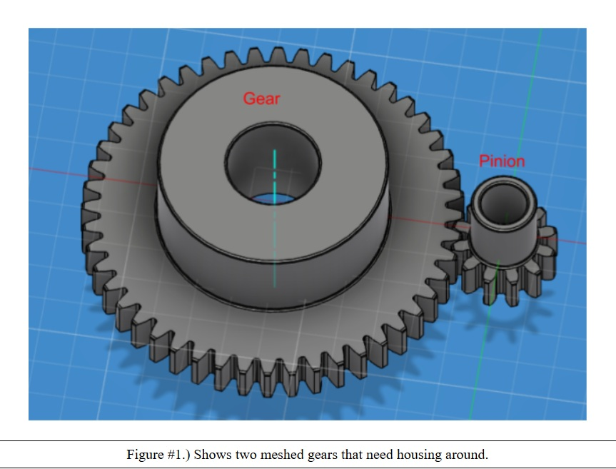
  
## Shaft Design 
 In order to design the input (power-transmission) shaft and the output (short) shaft I needed to find the appropriate equations to get the power going through the shafts, the torque applied on each shaft, and the speed of each shaft. Given a 24:9 ratio, I was able to use this to solve for torque and speed. The equation for the power was derived from the machinery's handbook and should be noted that for our input shaft we needed to use a maximum shear stress of 4000psi and for our output shaft we needed to use a max shear stress of 8500psi. Once I had these equations, I was able to then solve for diameters relating to power and torque. The diameters I solved for each input and output shaft were within limits, which meant there was no need to alter original diameters.

 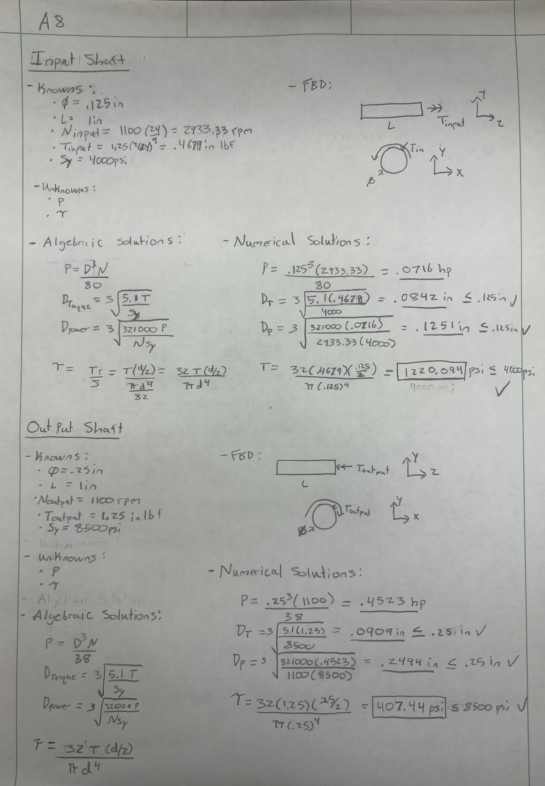

## Journal Bearing Design
For the Journal Bearings we were provided with many options from the McMaster-Carr catalog, to choose the correct bearing we still needed to know which material to use and the thickness of our bearing. To choose an appropriate material we solved for pressure, velocity, and PV rating. This led me to assume a bearing length of a 1/4in and given that these are designing to be running/sliding fits I used the RC5 table to determine the inner bearing diameter for both shafts. from here I solved for pressure, velocity, and PV rating and determined that the best material to use would be a Graphite (dry). The next step in the bearing design process was to solve for a thickness; to do so I used the pressure/axial stress formula. I did this by using the radial force acting on the bearing and used the cross-sectional area of the bearing diameter where I was able to derive the thickness for each of the bearings. 

### Bearing Material 

**- Input Bearing** 

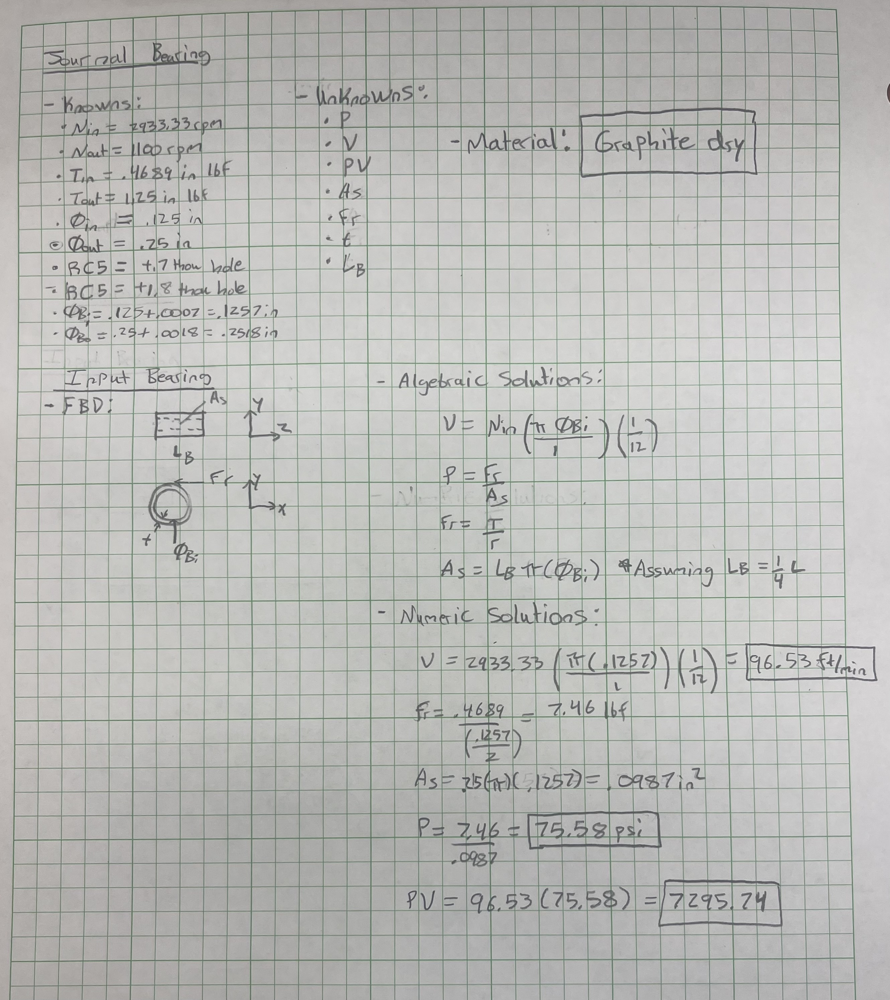

**- Output Bearing**

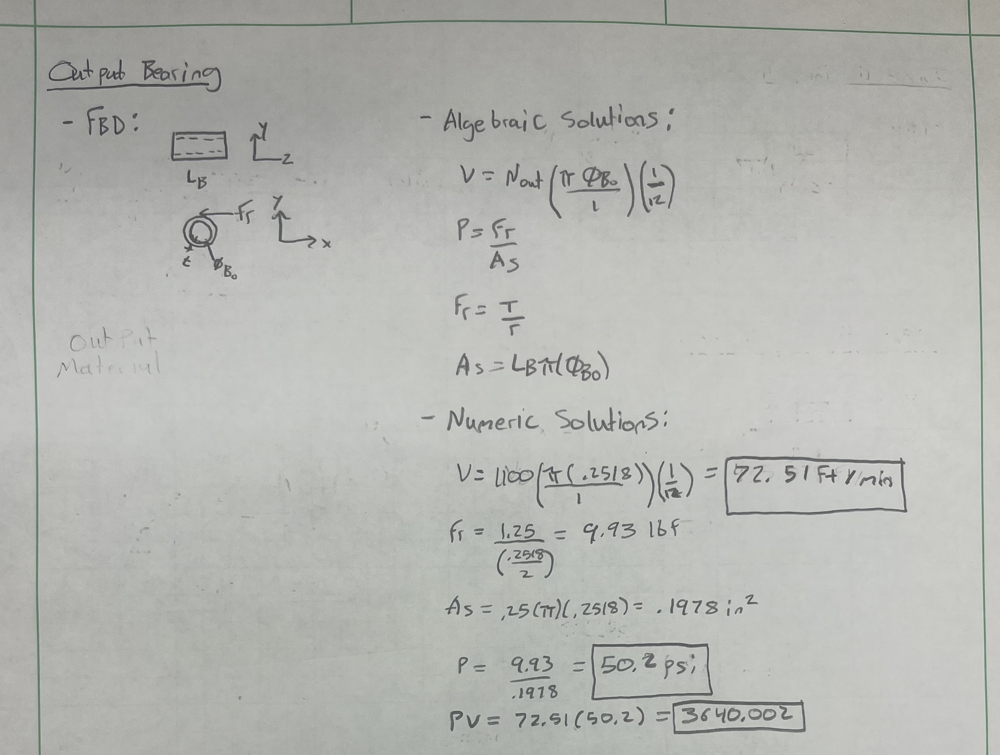

### Bearing Thickness

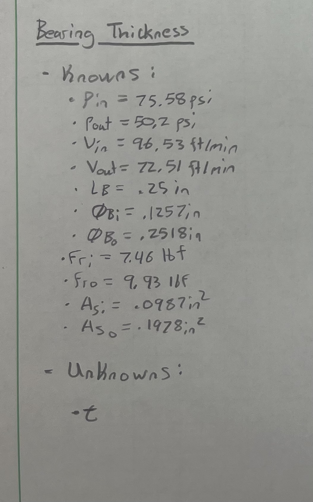
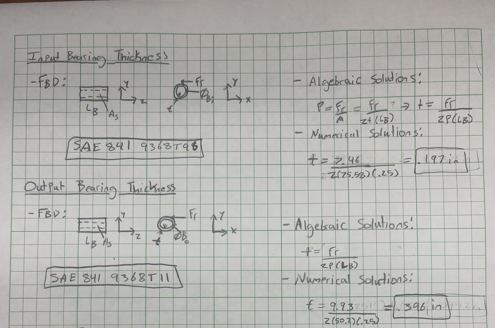

## CAD Design/Assembly
Since McMaster-Carr provided downloadable versions of the gear, pinion, and journal bearings; I was only tasked with designing the shafts and housing. Designing the shafts and assembly were pretty simple, I used the given diameters and lengths for the shafts and added chamfers since they would be a press fit. For the housing I used the gear, pinion, and bearing dimensions to design a housing that would comfortably fit all the necessary parts without coming undone. The housing fitment required either a bolt and hold fit or a snap fit, I chose to use a snap fit because the gear and pinion we were using were so small that bolting the housing together would have just been overkill. this would also save more material on the manufacturers end. Once all parts were designed, I used SolidWorks assembly to assemble them together, in order to mate the gears together I had to use a mechanical mate option with a 24:9 ratio. Keep in mind that all dimensions in SolidWorks are in Imperial units, specifically inches. 

### Shafts

**- Input Shaft**

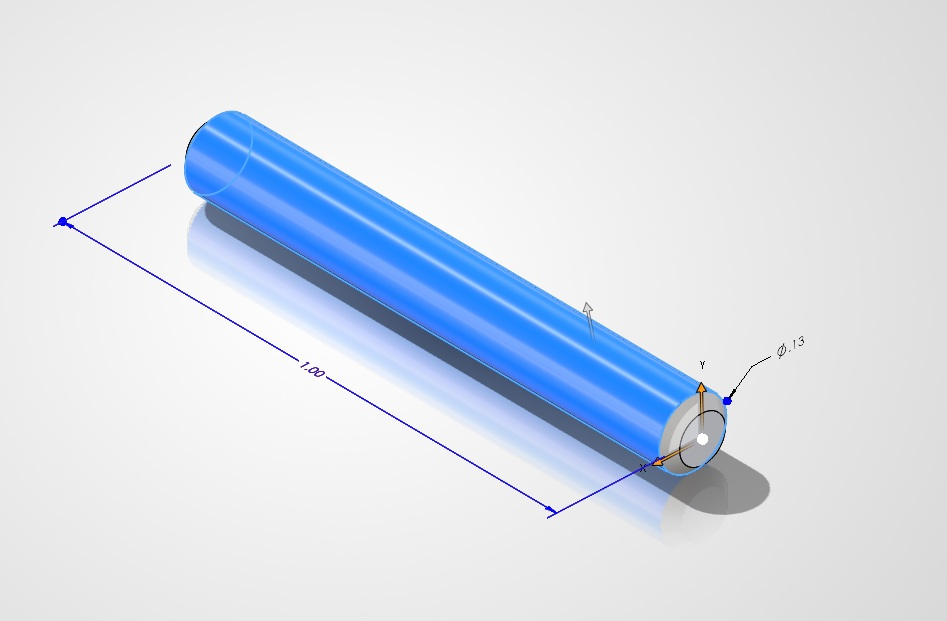

**-Output Shaft**

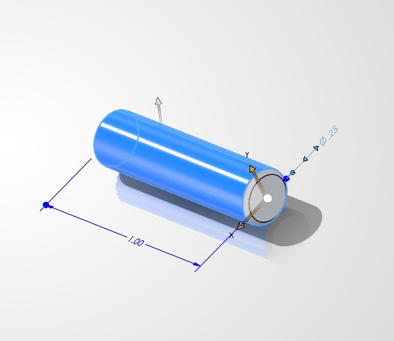

### Gearbox 

**- Handrawn Design**

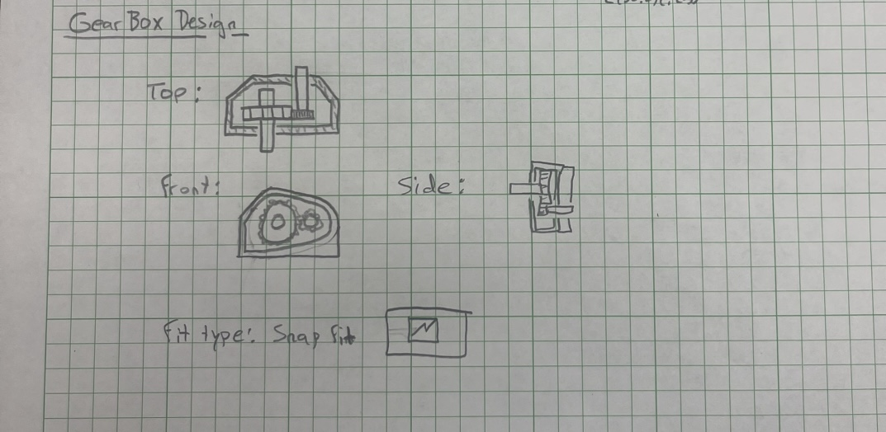

**- CAD Design**

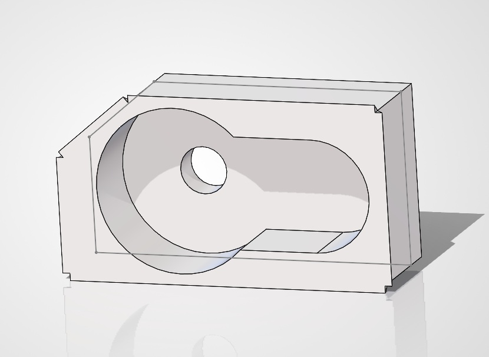

### Assembly

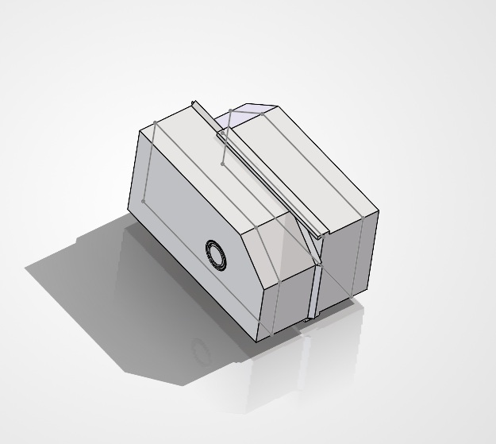

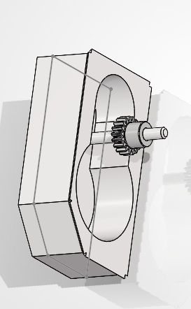

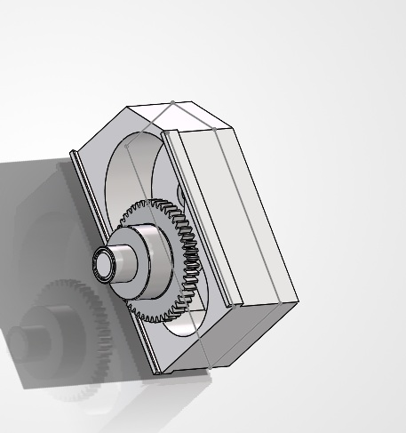

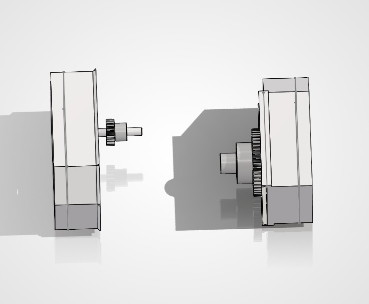

## Lessons Learned 
In total this took me about 9 hours to complete, most of that time was spent in SolidWorks. The biggest lesson I learned was using SolidWorks, McMaster-Carr did not offer downloadable versions of the gear, pinion, and bearings that worked with Creo which led me to use SolidWorks. I haven't used SolidWorks since my sophomore year in high school which is about 7 or 8 years give or take, so I was very unfamiliar with it. This led to some troubles when putting together the assembly and made me realize that I need to be more familiar with this software considering its arguably the most well-known and most used CAD software's. I did learn how to calculate thickness of a bearing when there is no given outer diameter which is very useful. Another thing I'm continuing to learn is just how useful the Machinery's Handbook is, becoming more familiar with this book and how to navigate and read it efficiently will become a very useful tool in my academic career as well as my post grad career. 

## CAD Files/Handwritten work PDF
[Download Assembly (.zip)](./assembly.zip)

