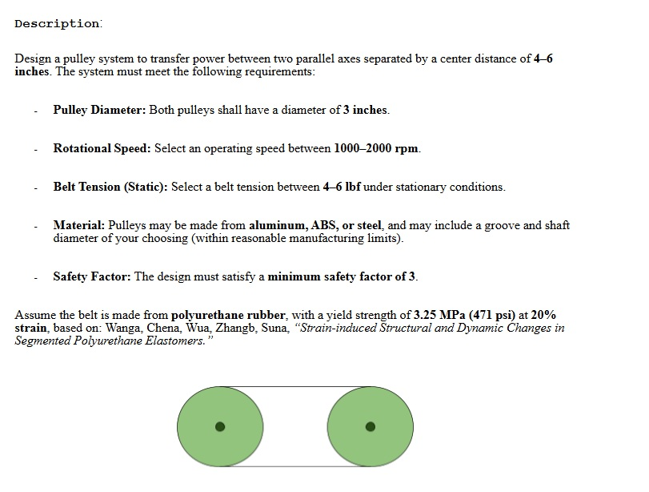
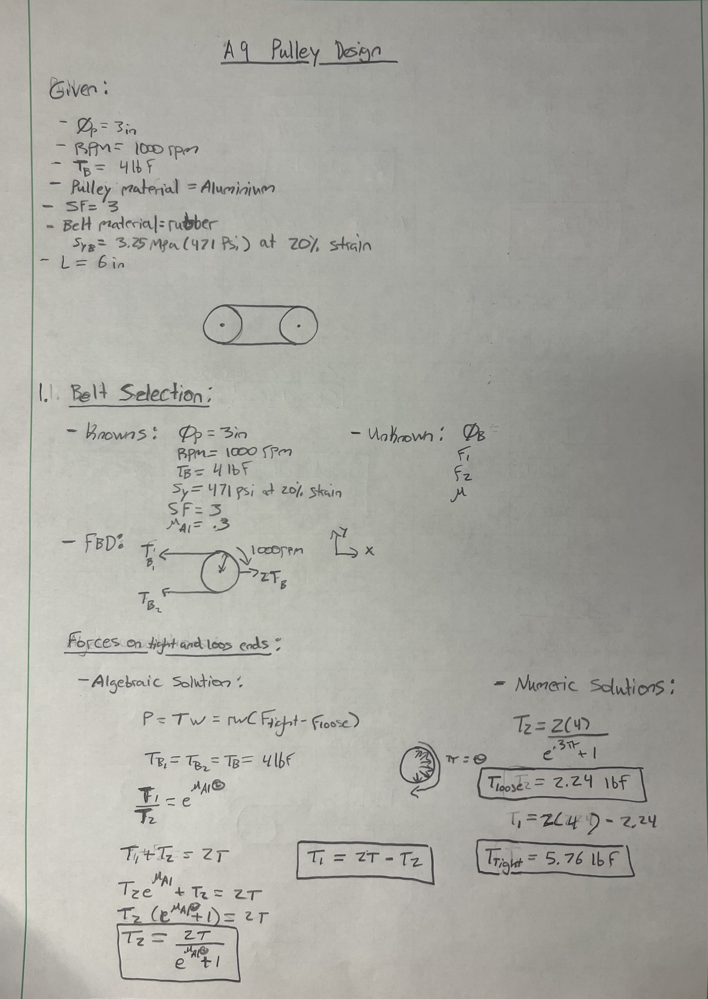
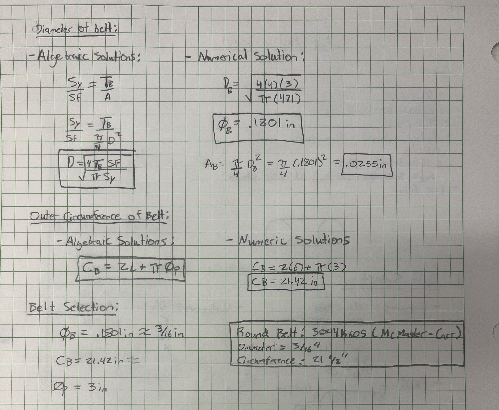
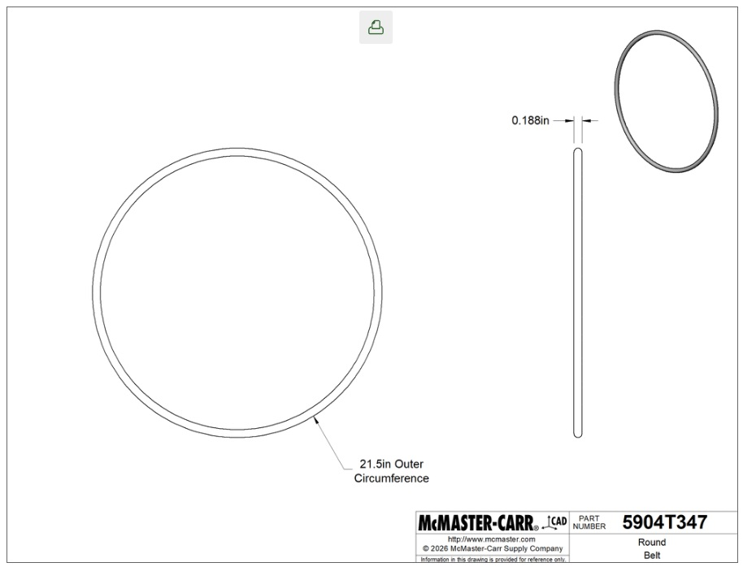
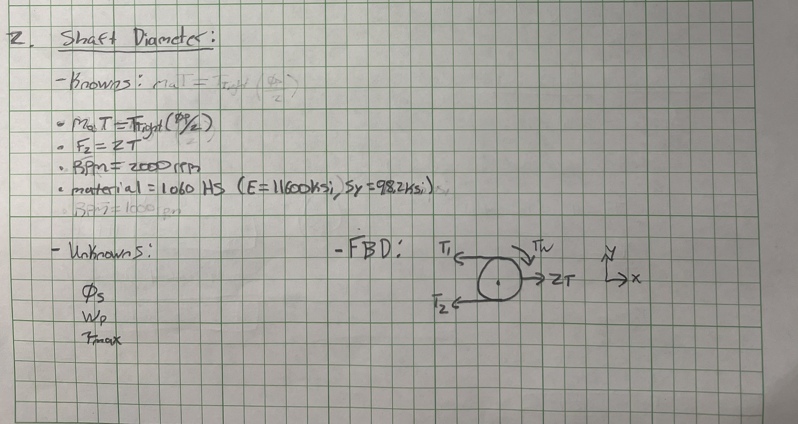
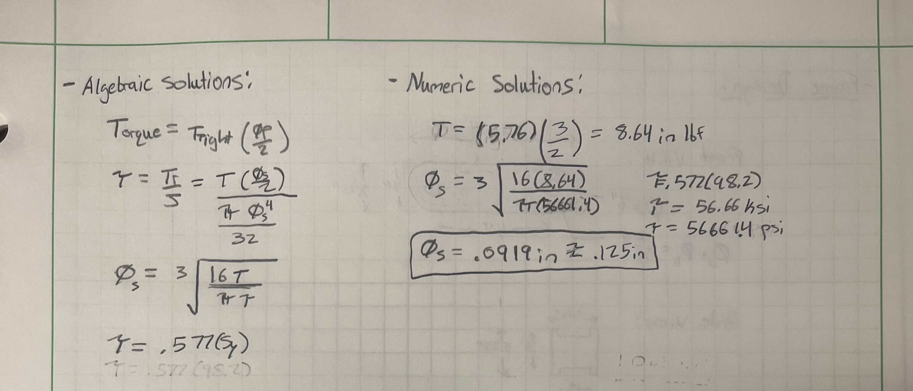
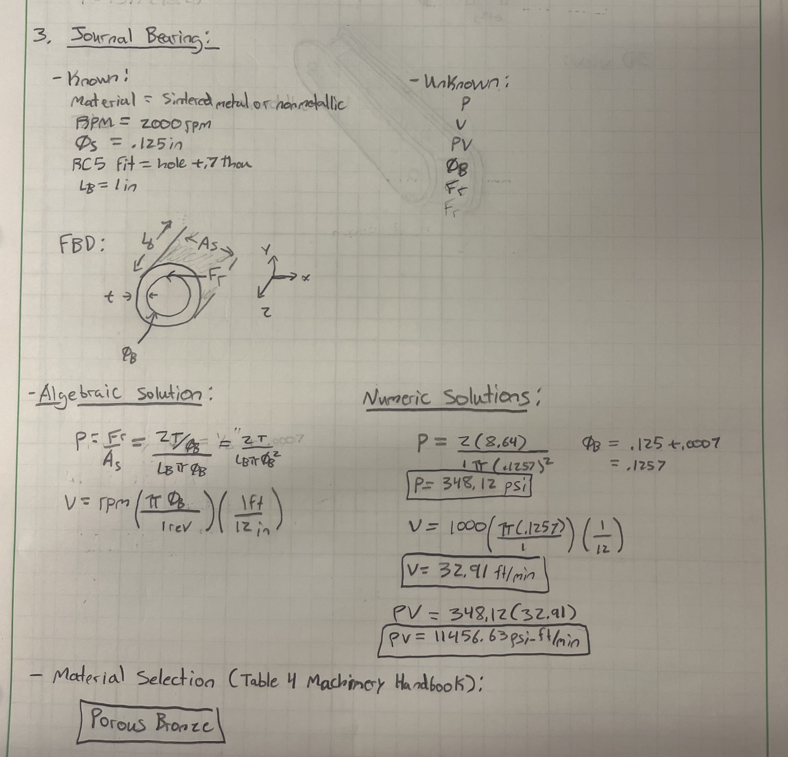
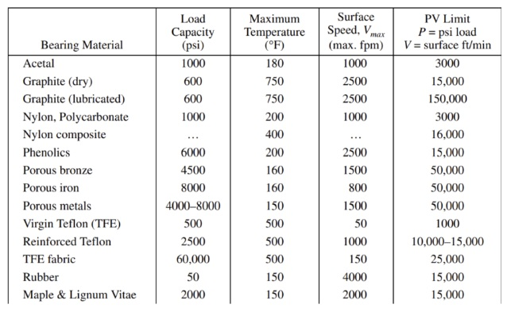
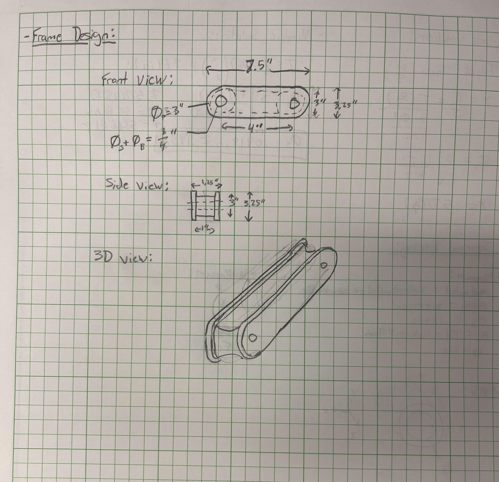

# A9 – Pulley System

## Objective

## Design Process

### Belt selection
In order to choose the correct size belt, the first thing I did was list out the givens specifications and a drew a quick sketch of the belt and pully diagram. This allowed me to create an idea of what the overall design would look like. The material I chose to use for the pully is aluminum which has a friction coefficient of .3 with a chosen safety factor of 3. Next, I listed the knowns and unknowns of the belt, with this information I created a free body diagram of the belt and pully relationship. To select the correct belt, I needed to know the belt diameter and outer circumference. To find these I used normal stress and yield strength equations factoring in my safety factor. After finding the diameter of the belt I plugged that value into the cross-sectional area equation to find its cross section. The outer circumference was found by plugging in the pully diameter and length into circumference equation. This led me to choose the rubber Round Belt 3044K605 from McMaster-Carr with a diameter of 3/16" and a circumference of 21.5". While creating this presentation I noticed a typo in my work and to avoid confusion it should be noted than in the work attached below the material selection box says (material = 3/16") when it should actually say (diameter = 3/16").

### Shaft Design
To design a shaft that would fit into the pully I followed a similar outline as the belt selection process. First thing I did was list my knowns and unknowns and drew a similar free body diagram to that of the belt and pully diagram. To find the diameter for the shaft I used torque and shear stress equations. Doing so gave me a value close to .125", so I used this as the shaft diameter. 

### Journal Bearing 
The journal bearing that I needed to use need to either be sintered metal or nonmetallic and needed to have an RC5 fit with a hole +.7 thousandths. I was able to pick the most necessary material based off of pressure, velocity, and PV value. The bearing hole diameter needed to be slightly larger than the shaft through which I was able to derive this measurement by summing the .7 thousandths and original shaft diameter. From here I plugged this value into the pressure equation and velocity equations. Once these values were obtained, I then determined that the best material to use would be a porous bronze based on Table 4 (pg. 2440) in the Machinery's Handbook.

### Frame Design

Using the derived dimensions from the previous steps I designed a frame for the pully system. for this design I chose to add side walls around the edges in order to guide the belt and keep it from flying off. This was done by simply adding extra length and height along the edges of the frame. 

## Lessons Learned

This assignment took a total of 6 hours, the major lessons I learned were how to use equations like torque to derive measurements, using PV values with the table to choose appropriate material, and finding loose and tight tensile forces applied on the pully. Although I was familiar with using torque and stress equations to obtain dimensions, I really hadn't practiced using torque to find these values and thought that was helpful to envision how the torque was acting on the pully. Using PV values is fairly simple but I was still able to gain more familiarity with the table and learn how to use it more efficiently. Finding the tight and loose tensile forces applied on the pully was fairly new and helped me to learn how those forces are working on the pully and how they relate to each other.  I also think that I am learning how to better draw 3D models as it is something I have struggled to do in the past. As a car enthusiast and overall machinery enthusiast this assignment helped me to better understand how belt systems work on machines such as flywheels, belt drive mills, and belt turning mechanisms on equipment. 

## Communicate

