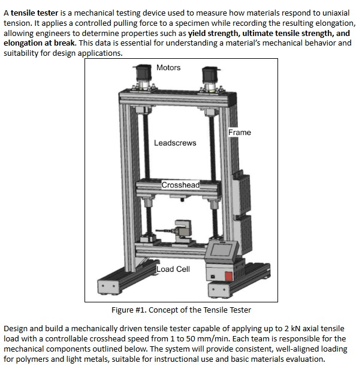
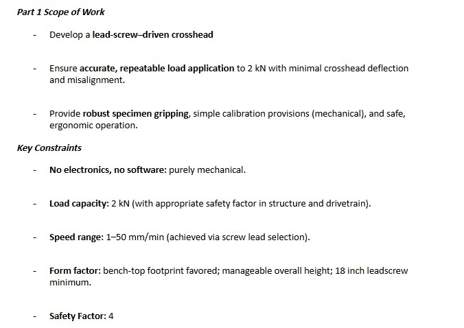
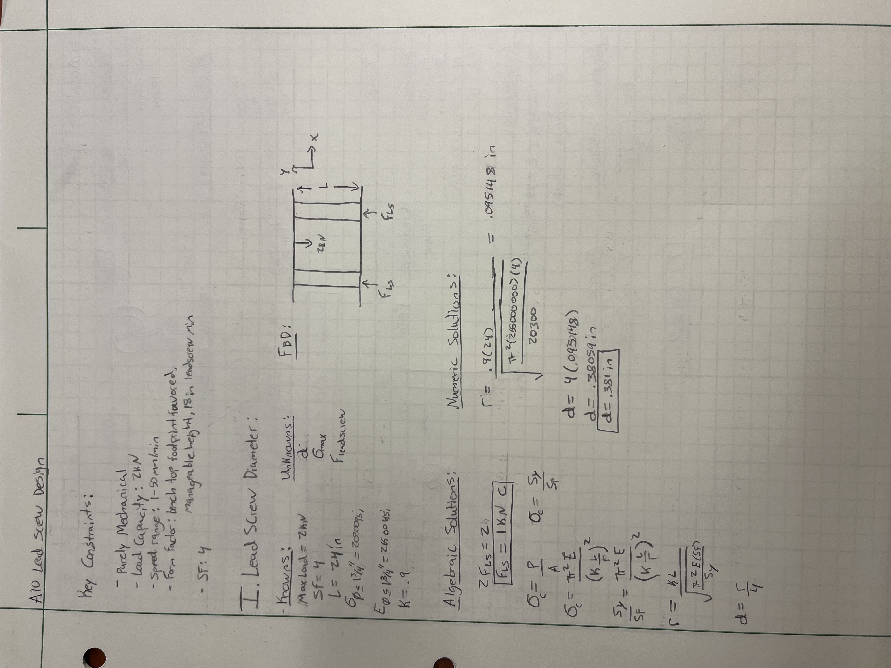
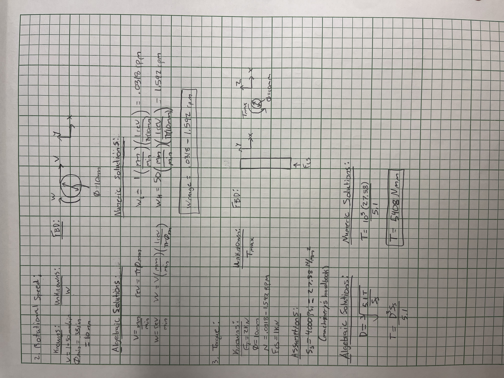
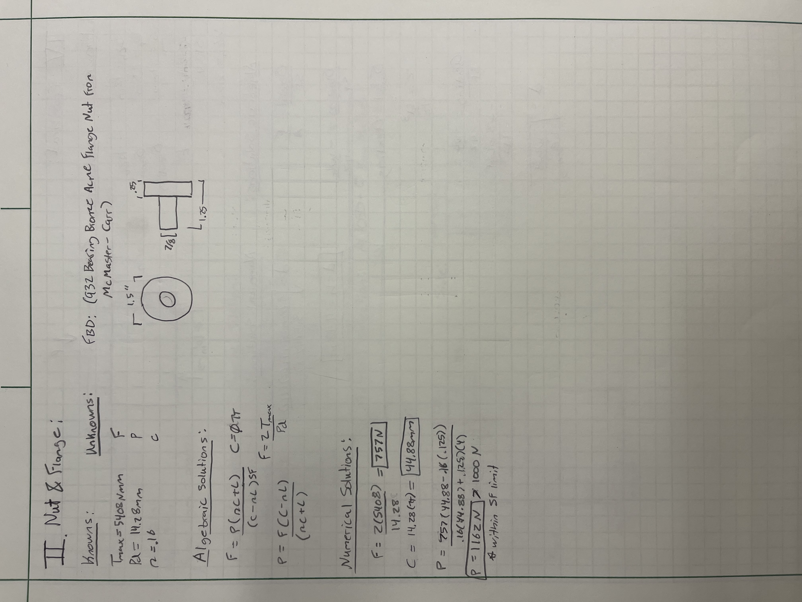
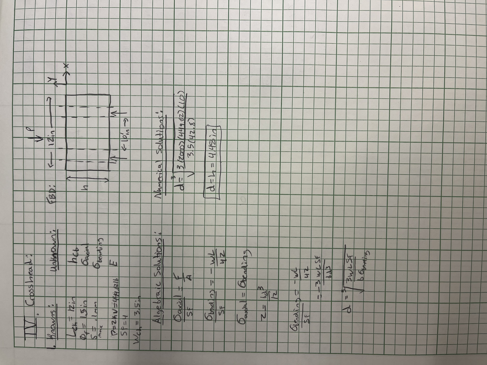
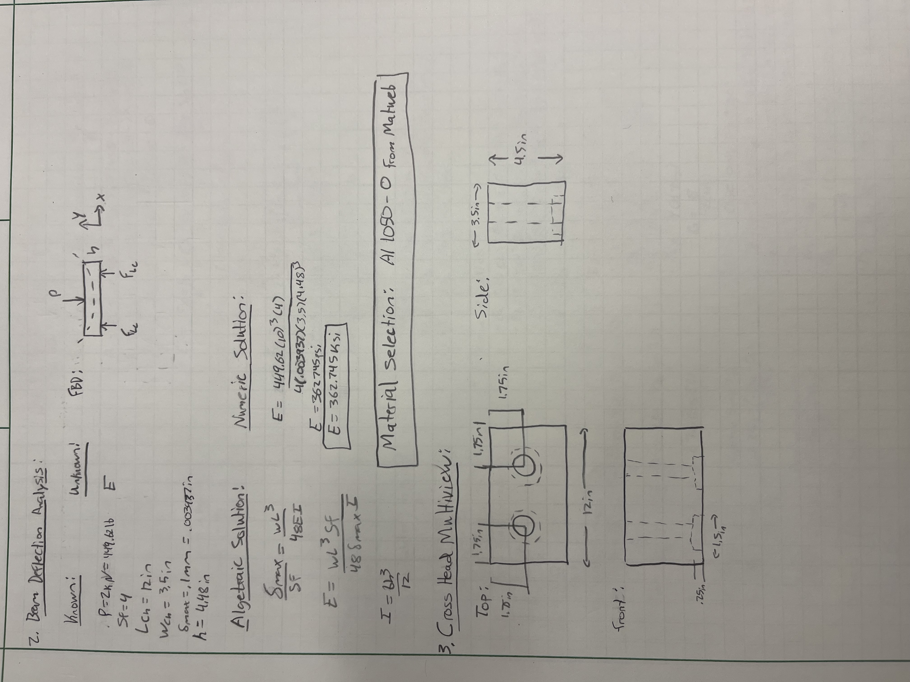

# A10 – Lead Screw Translating System

## Objective

### Leadscrew Selection
In order to choose the correct lead screws for the tensile Tester I first needed to calculate the leadscrew diameter. To find the diameter I was able to use Stress equations, before doing so I did some research on ACME leadscrew materials using Roton to determine elasticity, stress of diameter, and strength coefficient of stainless steel. The given minimum leadscrew length was 18, however for simplicity's sake as well as screw availability I bumped this to 2ft. From here I created an FBD and was able to solve for the diameter. Using the diameter I then solved for rotational speed range; to do so I utilized AI to convert SI units to metric> I continued to do this throughout the assignment to save a little bit of time. From here I solved for the torque using the equation from the Machinery's Handbook. Once these values had been determined, I decided to go with the 98935A914 5/8"-8 carbon steel leadscrew from McMaster-Carr. 

### Nut and Flange Selection
I chose the 932 Bearing Bronze ACME Flange Nut from McMaster-Carr; to verify this would sustain the applied load to the threads I needed to find the force applied to the nut. To do this I used the force equations provided in the lecture notes, although the force was slightly higher than the threshold it was still within the safety factor. 

### Crosshead Design
The only part that I needed to design from scratch was the cross head. To do so I listed the knowns and unknowns and created a free body diagram showing overall dimensions and forced acting on it. From here I used axial and bending stress calculations to solve for the height. In order to determine what material, I needed to use I used beam deflection analysis to solve for material properties. Given the Loads applied to the crossheads I used deflection and inertia equations from the machinery's handbook to derive the equation for the materials elasticity. After finding necessary elasticity I used mat web to choose 1050-0 Aluminum for the crosshead. In order to draft this in SolidWorks later on I created a multiview sketch providing the front, top, and side views. 

### Costs

| Item # | Quantity | Name | Cost/Item | Cost | Purchase Link |
| :--- | :---: | :--- | ---: | ---: | :--- |
| 804T48 | 1 | T-Slot Framing System: Rectangle, 40 Series, Smooth, Double, 3 m Nom Lg, 80 mm x 40 mm, 6 Slots, Std | $245.87 | $245.87 | [Grainger](https://www.grainger.com/product/80-20-T-Slot-Framing-System-Rectangle-804T48) |
| 95120A119 | 2 | 932 Bearing Bronze Acme Flange Nut | $138.20 | $276.40 | [McMaster-Carr](https://www.mcmaster.com/95120A119/) |
| 98935A914 | 2 | Carbon Steel Acme Lead Screw | $10.29 | $20.58 | [McMaster-Carr](https://www.mcmaster.com/98935A914/) |
| | | | Total Cost | $542. 85 | |

## Communicate

